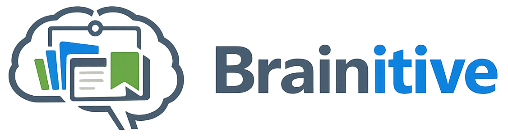
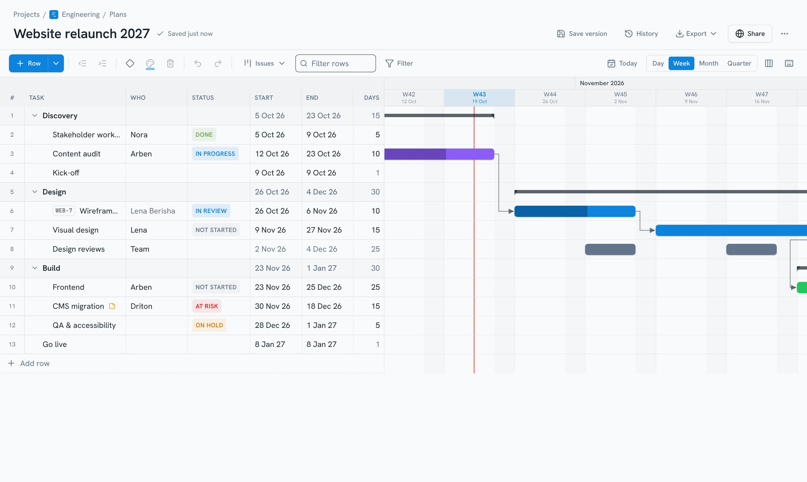
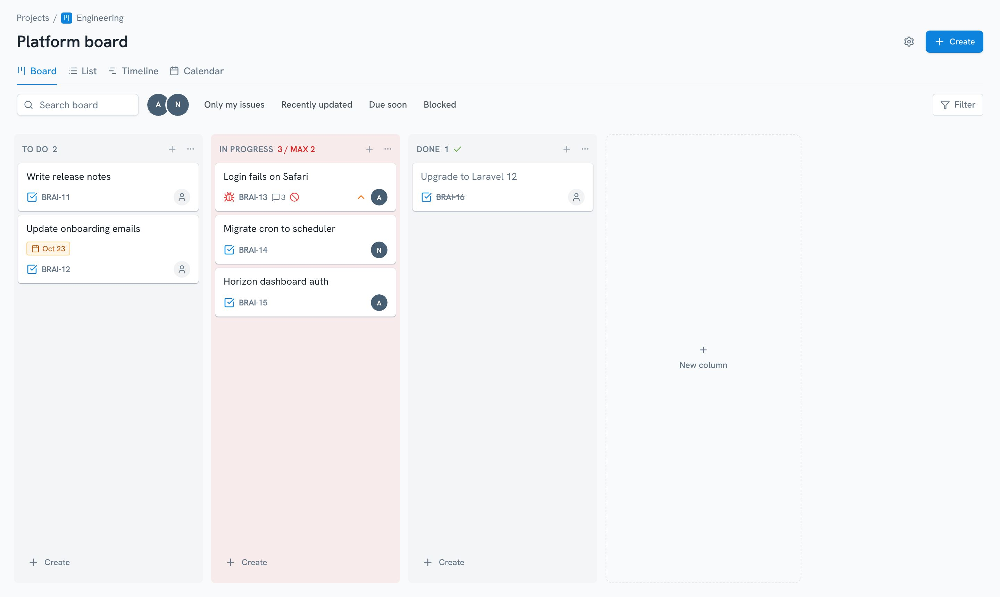
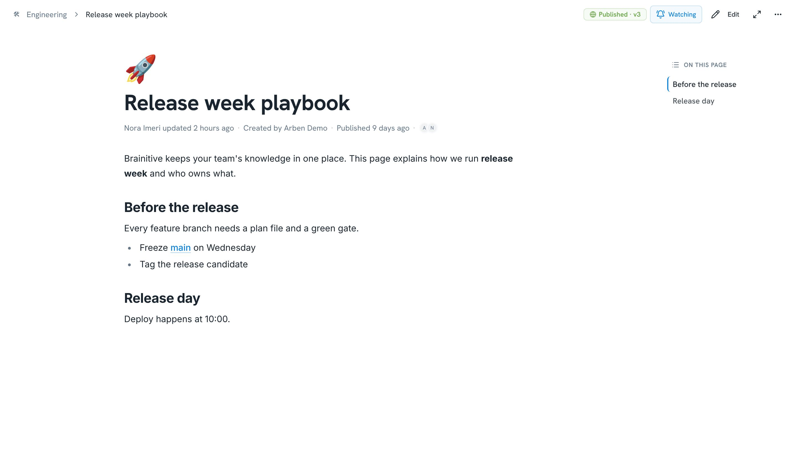
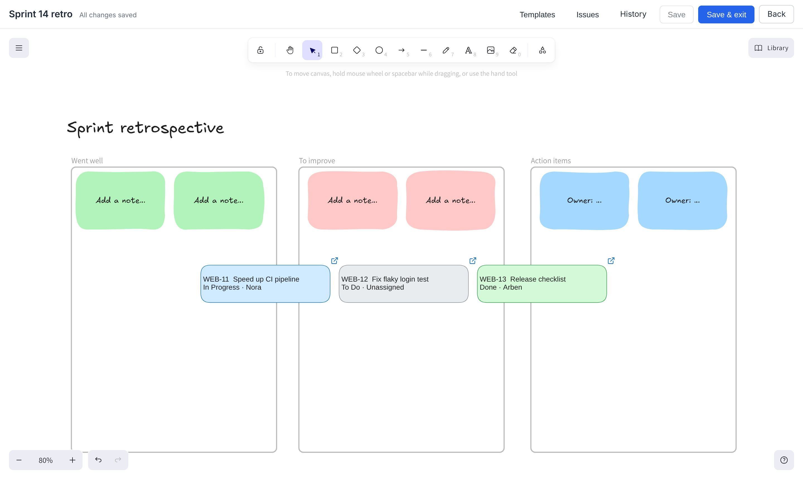

<p align="center">
  
</p>

<p align="center">
  <strong>Boards, docs, whiteboards and Gantt plans — one open-source workspace for the whole project.</strong>
</p>

<p align="center">
  <a href="https://www.brainitive.app">Website</a> ·
  <a href="https://www.brainitive.app/#pricing">Cloud</a> ·
  <a href="https://docs.brainitive.app">Docs</a> ·
  <a href="https://docs.brainitive.app/self-hosting/">Self-hosting</a> ·
  <a href="CONTRIBUTING.md">Contributing</a> ·
  <a href="LICENSE">Licence</a>
</p>

<p align="center">
  <a href="https://github.com/armendzekjiri/brainitive/actions/workflows/deploy.yml"></a>
  <a href="https://github.com/armendzekjiri/brainitive/actions/workflows/pre-release.yml"></a>
  <a href="https://github.com/armendzekjiri/brainitive/actions/workflows/e2e-nightly.yml"></a>
  <a href="https://github.com/armendzekjiri/brainitive/releases/latest"></a>
  <a href="LICENSE"></a>
  <a href="https://github.com/armendzekjiri/brainitive/stargazers"></a>
</p>

## Get Brainitive

**Brainitive Cloud** — hosted for you, updates and backups included. Free during early
access; paid plans come later and are announced in advance. →
[www.brainitive.app](https://www.brainitive.app/#pricing)

**Self-hosted** — free and complete, on your own server. Two files and our ready-made image
(`ghcr.io/armendzekjiri/brainitive`), nothing to build:

```bash
mkdir brainitive && cd brainitive
curl -fsSLO https://raw.githubusercontent.com/armendzekjiri/brainitive/main/compose.yaml
curl -fsSL https://raw.githubusercontent.com/armendzekjiri/brainitive/main/.env.docker.example -o .env   # then set DB_PASSWORD
docker compose up -d                           # open http://localhost:8080
```

HTTPS, backups, updates and optional features: **[docs.brainitive.app/self-hosting](https://docs.brainitive.app/self-hosting/)**
(configuration, sign-in with Google / Microsoft / GitHub, calendars, the GitHub App and more — the
short version lives in [docs/self-hosting.md](docs/self-hosting.md)).

**Browser extension** — save pages, links, screenshots and snippets to Brainitive from any tab, for
Cloud or your own server →
[Chrome Web Store](https://chromewebstore.google.com/detail/brainitive/mnnkcbjdgphgiiapdfegpgdmjekofmjn)
(Chrome, Edge, Brave).

**CLI** — capture, issues (with screenshots), tasks, snippets, docs and search from your terminal,
plus `brainitive mcp` for AI tools on your machine. One command installs it on macOS, Linux or
Windows: `curl -fsSL https://github.com/armendzekjiri/brainitive/releases/latest/download/install.sh | sh` →
[docs](https://docs.brainitive.app/integrations/cli), source in [`cli/`](cli/).



## What's inside

- **Boards** — Kanban or Scrum: sprints, backlog, burndown and velocity, issue history, WIP
  limits, time tracking, shareable filters, list / timeline / calendar views.
- **Plans** — Gantt timelines with milestones, dependencies, templates, Excel import /
  export, share links; rows can be linked to board issues and stay in sync.
- **Docs & wiki** — distraction-free editor with slash commands, drafts, publishing and
  version history.
- **Whiteboards** — Excalidraw with templates, autosave and history; turn sticky notes into
  issues and see them as live cards.
- **Lists, My Work, Calendar** — light to-dos, everything assigned to you, Google Calendar &
  Tasks sync.
- **Helpdesk** — embeddable support widget and ticket portal.
- **AI** — an MCP server so Claude or ChatGPT can read and update your workspace — or set up a
  whole project from a Jira export — plus bring-your-own-key writing helpers.
- **Snippets & bookmarks**, roles and permissions, notifications and web push.

| Boards | Docs | Whiteboards |
|---|---|---|
|  |  |  |

## Development

Laravel 12 · Inertia 2 · React 18 + TypeScript · Tailwind · PHPUnit.

```bash
cp .env.example .env
composer install && npm ci
php artisan key:generate && php artisan migrate --seed
composer run dev
```

Architecture, conventions and pitfalls are documented in [`docs/ai/`](docs/ai/README.md).
Read [CONTRIBUTING.md](CONTRIBUTING.md) before opening a pull request.

## Security

Found a security issue? Please **don't** open a public issue — report it privately at
**[brainitive.app/support/security-issue](https://www.brainitive.app/support/security-issue)**.
Details and scope: [SECURITY.md](SECURITY.md).

## Licence

Brainitive is open source: all of the code is public, and you may read, change and self-host it.
It is licensed under the [Business Source License 1.1](LICENSE) with these terms:

- **Free to self-host** — also in production and for businesses — if your organization (counted
  together with its group companies) has **less than €2 million annual revenue**. Personal,
  non-profit and educational use is always free.
- **Agencies and IT contractors** may install and run Brainitive for a client; the client's
  revenue counts.
- **Not allowed without a commercial licence:** offering Brainitive, or a service based on it, to
  others as a hosted or subscription service (competing with Brainitive Cloud), or production use
  by an organization with €2 million or more annual revenue.
- **Every version becomes AGPL-3.0** four years after its release.

Versions up to and including 1.45.3 were released under the AGPL-3.0 and remain available under
it. Commercial licences: hello@brainitive.app.

"Brainitive" and the logo are trademarks of the project owners; the licence covers the code,
not the name.
